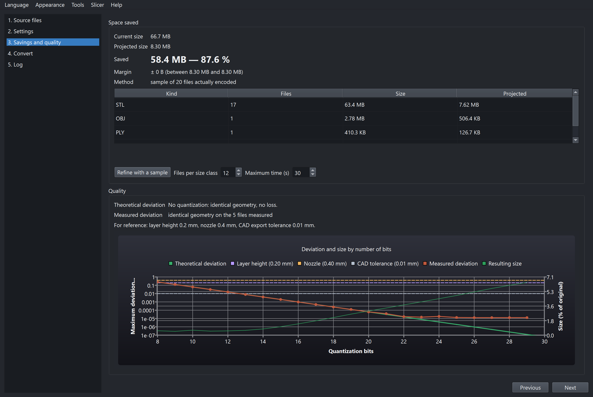
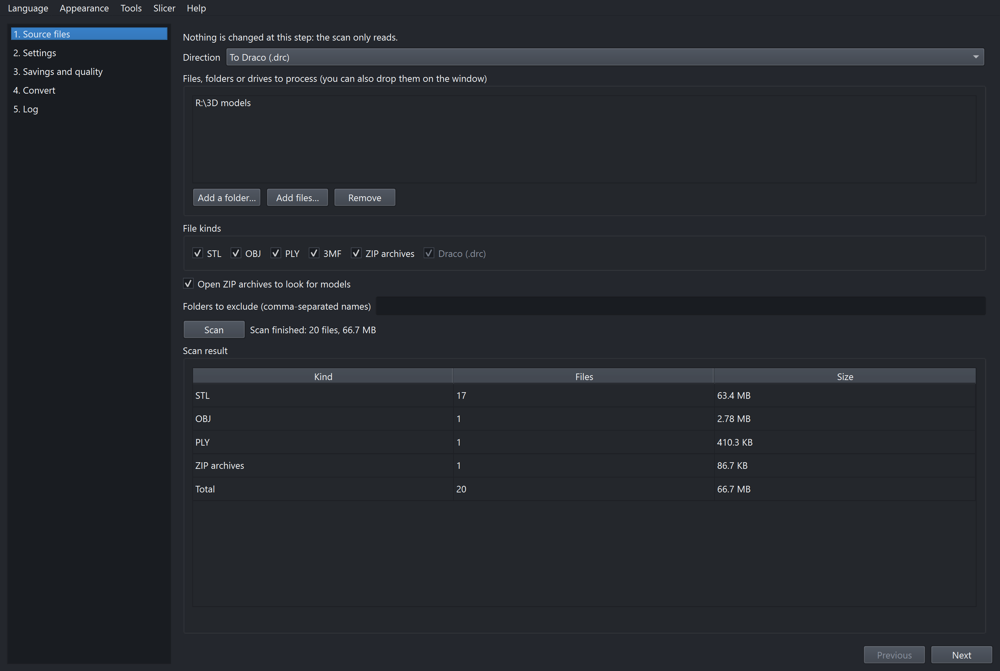
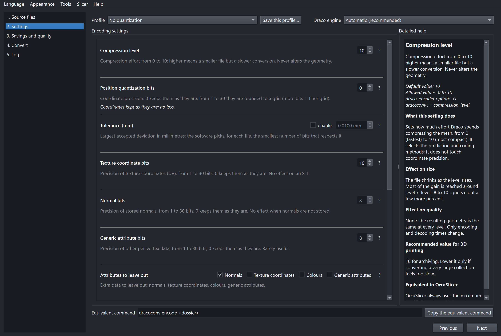
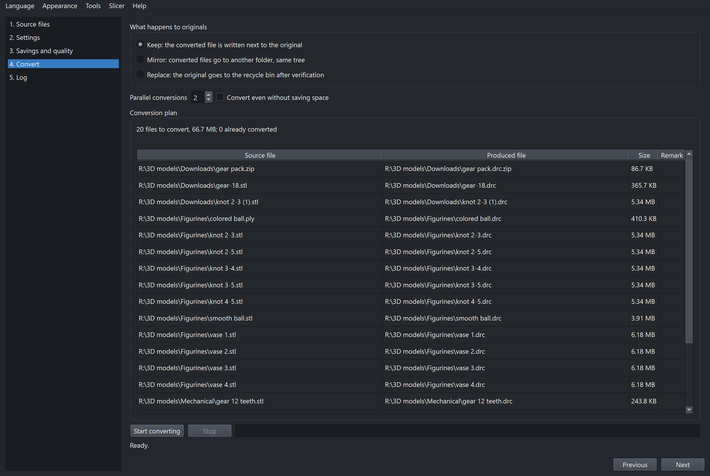
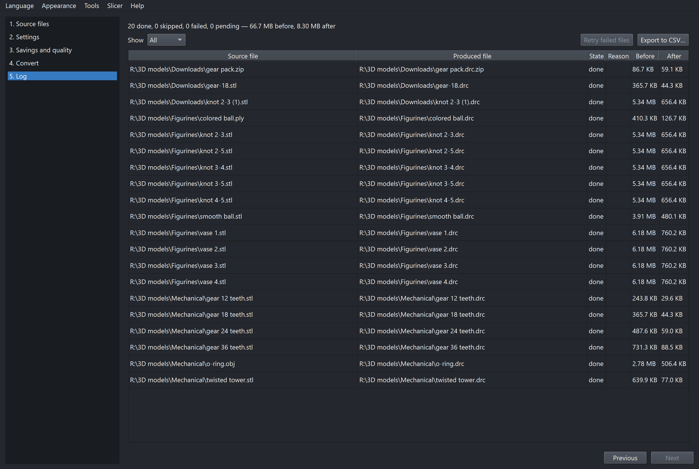
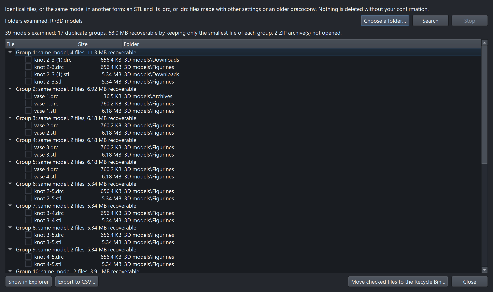

# dracoconv

*[Version française](README.md)*

A Draco (`.drc`) converter for 3D models, both ways, on a file, a folder or a whole drive. Before converting, it tells you how much space you can expect to save and how much quality the chosen settings cost.



Built to archive a collection of 3D-printing models: the `.drc` files open in OrcaSlicer, and convert back to STL for software that does not read Draco yet.

- **To `.drc`** from STL (ASCII and binary), OBJ, PLY, 3MF (geometry only), and those formats inside ZIP archives.
- **From `.drc`** to binary STL, OBJ or PLY.
- **Window and command line**, in French and English.
- **Every setting of the Draco encoder**, each one explained.

## What to know before using it

- **Without quantization (the default), geometry is kept bit for bit.** Every produced file is read back and compared with its source before being reported as good. Only the order of triangles changes and, for an STL, the header and the stored normals.
- **An original is never touched by default.** "Replace" mode must be confirmed and sends the original to the recycle bin only after verification and a read-back of the written file. It never applies to 3MF or ZIP files, nor to a file whose conversion leaves data out (textures, colours, normals or materials of an OBJ, for example). On a volume without a recycle bin (network, USB stick), the original is kept.
- **The recycle bin has a size limit.** When it overflows, Windows purges its oldest items without warning. Before replacing tens of gigabytes, check its maximum size in its properties, or prefer mirror mode.
- **3MF: conversion loses data** (plates, print settings, colours, object separation) and rarely saves space, since a 3MF is already compressed. Bambu Studio and OrcaSlicer project files are not read and are left as they are. `.gcode.3mf` files are ignored.
- **Non-watertight models and OrcaSlicer.** On a surface that is not watertight, Draco's most compact encoding duplicates some vertices. The triangles stay identical, but OrcaSlicer then counts many more open edges than in the original STL. The **"Keep topology"** setting, on by default, detects those models and encodes them differently: this greatly reduces connectivity differences in OrcaSlicer, at the cost of larger files. Reading Draco directly may still differ slightly from reading STL; converting back to STL restored the original statistics exactly on the two models checked. On a collection of figurines, where almost nothing is watertight, this changes the savings a lot: 30% of the original size instead of 12% on the test folder. Turn it off (`--no-keep-topology`) for the most compact archive, to be converted back to STL before use. Details and figures in [docs/mesures.md](docs/mesures.md) (in French).
- **Beyond about 22 bits, quantizing gains no more precision** for a model of ordinary size: the limit becomes that of the numbers in the original file.

## The interface in pictures

| | |
|---|---|
|  |  |
| **1. Source files**: read-only scan. | **2. Settings**: every setting explained, with the equivalent command. |
|  |  |
| **4. Convert**: the plan, file by file, before starting. | **5. Log**: size before and after for each file. |



**Duplicates** ("Tools" menu): an STL and its `.drc`, copies downloaded twice, an older conversion.

Screenshots taken on generated demo models (`tools/demo_models.py`, `tools/screenshots.py`).

## Installation

**Easiest:** download `dracoconv-<version>-setup.exe` from the [releases](https://github.com/DrFreeman001/dracoconv/releases/latest) and run it. Per-user install, no administrator rights, uninstall from "Installed apps". The installer is not signed, so Windows SmartScreen may say "unknown publisher": "More info", then "Run anyway".

**From source:** Windows, Python 3.11 or newer.

```bash
git clone https://github.com/DrFreeman001/dracoconv.git dracoconv
```

```bash
cd dracoconv
```

```bash
py -m venv .venv
```

```bash
.venv\Scripts\python -m pip install -e .
```

### Version without Python

To get a folder that runs on a PC without Python (window `dracoconv-gui.exe` and command line `dracoconv.exe`, about 250 MB):

```bash
.venv\Scripts\python -m pip install pyinstaller
```

```bash
pwsh tools/build_exe.ps1
```

The result is in `dist/dracoconv`; copy the whole folder. To turn it into an installer (Inno Setup 6 required):

```bash
pwsh tools/build_installer.ps1
```

### Reference engine

The built-in engine is enough for everyday use. Three settings (`--metadata`, `--preserve-polygons`, `--generic-bits`) and 30 bits also need Google's official tools, built once (git and the Microsoft C++ build tools are required):

```bash
.venv\Scripts\python -m pip install cmake
```

```bash
pwsh tools/build_draco.ps1
```

## The window

```bash
.venv\Scripts\dracoconv-gui
```

Five steps:

1. **Source files** — pick files, folders or drives, and the direction. The scan only reads.
2. **Settings** — each setting shows a sentence of explanation, a tooltip, its concrete effect on your models, and detailed help in the right-hand panel.
3. **Savings and quality** — instant projection, then refined on a sample that is actually encoded, with a margin of error; theoretical and measured deviation; size / deviation curve by number of bits.
4. **Convert** — what happens to originals (keep, mirror, replace), detailed plan, start, stop.
5. **Log** — result file by file, CSV export, retry of failed files.

**Right-click in Explorer** (with the installer, option checked by default): "Convert to .drc with dracoconv" on STL, OBJ, PLY and 3MF files, "Convert from .drc" on `.drc` files, "Convert with dracoconv" on a folder. On Windows 11 these are under "Show more options". Selecting several files opens a single window, already scanned; nothing is converted until you confirm. From the command line: `dracoconv-gui [--encode|--decode] paths...`.

**Open a .drc in your slicer**: Bambu Studio, OrcaSlicer and PrusaSlicer cannot read Draco. Right-click one or more `.drc` files, "Open in slicer": dracoconv decodes them to temporary STL files (checked, deleted after two days) and opens the whole selection in a single slicer window. Pick the slicer in dracoconv's "Slicer" menu; by default, the first one found. Command line: `dracoconv-gui --slicer files.drc...`.

**Duplicates**: "Tools" menu, "Find duplicates…" (or `dracoconv duplicates folders... [--csv file.csv]`). Finds identical files, and the same model in another form: an STL and its `.drc`, or `.drc` files made with other settings or an older dracoconv. The comparison uses the geometry (triangles, size, area, volume, spread of the surface), with a tolerance that covers Draco's rounding; a model that was only moved is still a duplicate, a variant with a moved detail is not. Nothing is deleted without confirmation: checked files go to the Recycle Bin, and at least one file per group stays. Measurements are cached, so a second search is almost instant. ZIP files are not opened.

**Watched folders**: "Tools" menu, "Watched folders…". dracoconv converts new models in these folders on its own (for example "Downloads"), with no program running all the time: a Windows Task Scheduler task starts it at sign-in and then every 15 minutes, hours or days; it converts what is new and exits. A single process at low priority, no run on battery; a file changed less than five minutes ago waits for the next run. Originals are kept, or sent to the Recycle Bin after checking if you confirm it. A Windows notification sums up each run that converted something.

**Drag and drop**: files or folders dropped on the window are added as with "Add". During a batch, the taskbar icon shows the progress, and a Windows notification reports the end when the window is not in front.

The **Help** menu links to the project page and controls the new-version notice: at most one check a day on GitHub, sending nothing but the request; uncheck it to stop.

The language is changed from the menu, without restarting. The **Appearance** menu offers **System**, **Light**, and **Dark**, and remembers the choice.

An animated bar shows activity during scanning, estimation, and conversion. The conversion counter displays completed files and the batch percentage; it does not claim to measure the encoder’s internal progress within one file.

## Seeing `.drc` files in Windows Explorer

Thumbnails and 3D preview of `.drc` (and STEP) files in Explorer: separate project [explorer-draco-step-preview](https://github.com/DrFreeman001/explorer-draco-step-preview).

## The command line

List the 3D files of a folder, changing nothing:

```bash
dracoconv --lang en scan "D:\Models"
```

Project the savings, instantly first and then on a sample that is actually encoded:

```bash
dracoconv --lang en estimate "D:\Models" --sample
```

Measure the quality loss for a given setting:

```bash
dracoconv --lang en quality "D:\Models\part.stl" --position-bits 14
```

Convert to `.drc`, converted files next to the originals:

```bash
dracoconv --lang en encode "D:\Models"
```

Convert into a mirror folder, writing nothing into the collection:

```bash
dracoconv --lang en encode "D:\Models" --originals mirror --mirror-dir "E:\Models-drc"
```

See the plan without doing anything:

```bash
dracoconv --lang en encode "D:\Models" --dry-run
```

Convert back to STL:

```bash
dracoconv --lang en decode "D:\Models" --format stl
```

Show the detailed help of a setting:

```bash
dracoconv --lang en params position_bits
```

Useful options: `--lang fr|en`, `--json`, `--workers N`, `--journal batch.sqlite` (running the same command with the same journal resumes an interrupted batch), `--profile`, `--engine dracopy|reference`.

Running `encode` again on a folder that was already processed redoes nothing: a produced file carries the date of its source, which is how already converted files are recognised.

## Settings

| Option | Role | Default |
|---|---|---|
| `--compression-level` | Compression effort from 0 to 10. Never alters the geometry. | 10 |
| `--position-bits` | Position quantization bits; 0 keeps coordinates as they are. | 0 |
| `--tolerance-mm` | Largest accepted deviation; the number of bits is worked out per file. | none |
| `--texcoord-bits` | Precision of texture coordinates. | 10 |
| `--normal-bits` | Precision of normals, when they are stored. | 8 |
| `--generic-bits` | Precision of other attributes. | 8 |
| `--skip` | Attributes to leave out: `normal`, `texcoord`, `color`, `generic`, or `none`. | `normal` |
| `--point-cloud` | Stores vertices without triangles. | no |
| `--preserve-order` | Keeps the order of vertices and triangles; larger file. | no |
| `--keep-topology` | On a non-watertight model, keeps every vertex unique; larger file for those models. | yes |
| `--metadata` | Keeps the object, group and material names of an OBJ. | no |
| `--preserve-polygons` | Keeps faces with four or more sides from an OBJ or PLY. | no |

The largest deviation of a vertex is `model size ÷ (2^bits − 1) × √3 ÷ 2`. Example: 14 bits on a 180 mm model give a step of 0.011 mm and a deviation of at most 0.0095 mm.

## Measurements

The compression ratios shipped with the software were measured on a real collection of printing models; see [docs/mesures.md](docs/mesures.md) (in French). The sampled projection replaces them with those of your own files.

## Development

```bash
.venv\Scripts\python -m pip install -e .[dev]
```

```bash
.venv\Scripts\python -m pytest
```

Interface texts live in `dracoconv/locales/fr.json` and `en.json`; a test fails if a key is missing in one language. Settings are described once, in `dracoconv/params.py`, which feeds the window, the command line and the help.

## License

Apache-2.0, like Draco. Draco is a Google project; OrcaSlicer and Bambu Studio belong to their respective authors.
