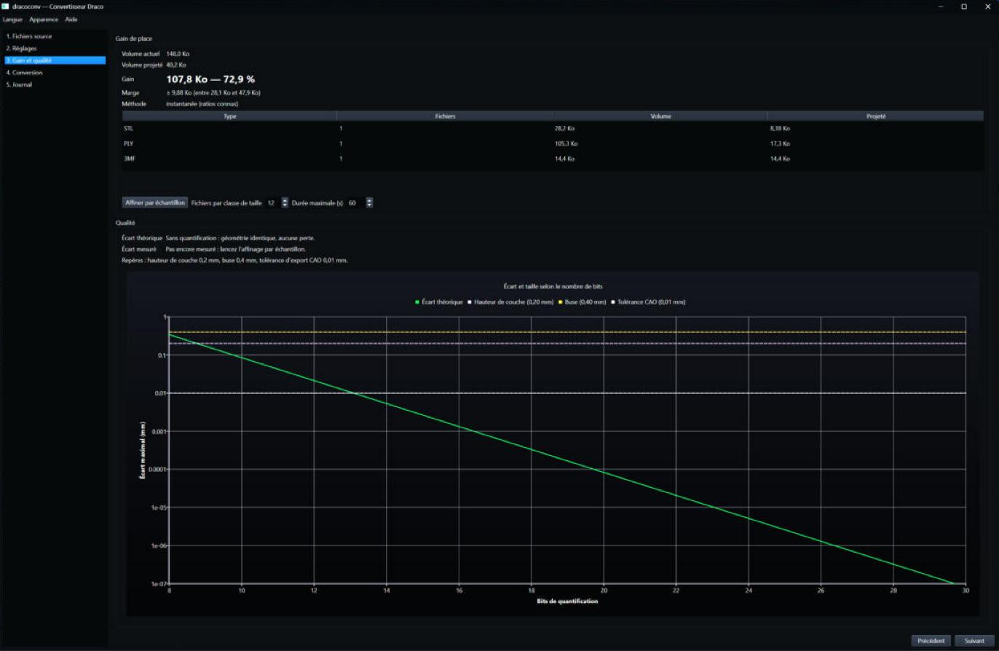

# dracoconv

*[English version](README.en.md)*

Convertisseur Draco (`.drc`) pour modèles 3D, dans les deux sens, sur un fichier, un dossier ou un disque entier. Avant de convertir, il annonce le gain de place attendu et la perte de qualité selon les réglages.



Pensé pour archiver une collection de modèles d'impression 3D : les `.drc` s'ouvrent dans OrcaSlicer, et se reconvertissent en STL pour les logiciels qui ne lisent pas encore Draco.

- **Vers `.drc`** depuis STL (texte et binaire), OBJ, PLY, 3MF (géométrie seule) et ces formats à l'intérieur d'archives ZIP.
- **Depuis `.drc`** vers STL binaire, OBJ ou PLY.
- **Fenêtre et ligne de commande**, en français et en anglais.
- **Tous les réglages de l'encodeur Draco**, chacun expliqué.

## Ce qu'il faut savoir avant de s'en servir

- **Sans quantification (réglage par défaut), la géométrie est conservée au bit près.** Chaque fichier produit est relu et comparé à sa source avant d'être déclaré bon. Seuls changent l'ordre des triangles et, pour un STL, l'en-tête et les normales stockées.
- **Un original n'est jamais touché par défaut.** Le mode « remplacer » doit être confirmé et envoie l'original à la corbeille seulement après vérification et relecture du fichier écrit. Il ne s'applique jamais aux 3MF, aux ZIP, ni à un fichier dont la conversion écarte des données (textures, couleurs, normales ou matériaux d'un OBJ, par exemple). Sur un volume sans corbeille (réseau, clé USB), l'original est conservé.
- **La corbeille a une taille limite.** Quand elle déborde, Windows en purge les éléments les plus anciens sans prévenir. Avant de remplacer des dizaines de gigaoctets, vérifiez sa taille maximale dans ses propriétés, ou préférez le mode miroir.
- **3MF : la conversion perd des données** (plateaux, réglages d'impression, couleurs, séparation des objets) et fait rarement gagner de la place, un 3MF étant déjà compressé. Les projets Bambu Studio et OrcaSlicer ne sont pas lus et sont laissés tels quels. Les fichiers `.gcode.3mf` sont ignorés.
- **Modèles non étanches et OrcaSlicer.** Sur une surface qui n'est pas étanche, l'encodage le plus compact de Draco dédouble certains sommets. Les triangles restent identiques, mais OrcaSlicer y compte alors bien plus d'arêtes ouvertes que dans le STL d'origine. Le réglage **« Préserver la topologie »**, coché par défaut, détecte ces modèles et les encode autrement : cela réduit fortement les écarts de connectivité dans OrcaSlicer, au prix de fichiers plus gros. La lecture directe du Draco peut encore différer légèrement de celle du STL ; le retour en STL a retrouvé exactement les statistiques originales sur les deux modèles vérifiés. Sur une collection de figurines, où presque rien n'est étanche, cela change beaucoup le gain : 30 % de la taille d'origine au lieu de 12 % sur le dossier d'essai. Décochez-le (`--no-keep-topology`) pour une archive la plus compacte possible, à reconvertir en STL avant usage. Détails et chiffres dans [docs/mesures.md](docs/mesures.md).
- **Au-delà de 22 bits environ, quantifier ne gagne plus en précision** pour un modèle de taille courante : la limite devient celle des nombres du fichier d'origine.

## Installation

**Le plus simple :** téléchargez `dracoconv-<version>-setup.exe` dans les [versions publiées](https://github.com/DrFreeman001/dracoconv/releases/latest) et lancez-le. Installation pour vous seul, sans droits d'administrateur, désinstallation depuis « Applications installées ». L'installateur n'étant pas signé, Windows SmartScreen peut afficher « éditeur inconnu » : « Informations complémentaires », puis « Exécuter quand même ».

**Depuis les sources :** Windows, Python 3.11 ou plus récent.

```bash
git clone https://github.com/DrFreeman001/dracoconv.git dracoconv
```

```bash
cd dracoconv
```

```bash
py -m venv .venv
```

```bash
.venv\Scripts\python -m pip install -e .
```

### Version sans Python

Pour un dossier utilisable sur un PC sans Python (fenêtre `dracoconv-gui.exe` et ligne de commande `dracoconv.exe`, environ 250 Mo) :

```bash
.venv\Scripts\python -m pip install pyinstaller
```

```bash
pwsh tools/build_exe.ps1
```

Le résultat est dans `dist/dracoconv` ; copiez le dossier entier. Pour en faire un installateur (Inno Setup 6 nécessaire) :

```bash
pwsh tools/build_installer.ps1
```

### Moteur de référence

Le moteur intégré suffit pour l'usage courant. Trois réglages (`--metadata`, `--preserve-polygons`, `--generic-bits`) et les 30 bits demandent en plus les outils officiels de Google, à compiler une fois (git et les outils de compilation Microsoft C++ sont nécessaires) :

```bash
.venv\Scripts\python -m pip install cmake
```

```bash
pwsh tools/build_draco.ps1
```

## La fenêtre

```bash
.venv\Scripts\dracoconv-gui
```

Cinq étapes :

1. **Fichiers source** — choisir fichiers, dossiers ou disques, et le sens de conversion. L'analyse ne fait que lire.
2. **Réglages** — chaque paramètre affiche une phrase d'explication, une infobulle, son effet concret sur vos modèles, et une aide détaillée dans le panneau de droite.
3. **Gain et qualité** — projection instantanée, puis affinée sur un échantillon réellement encodé, avec marge d'erreur ; écart théorique et mesuré ; courbe taille / écart selon le nombre de bits.
4. **Conversion** — sort des originaux (garder, miroir, remplacer), plan détaillé, lancement, arrêt.
5. **Journal** — résultat fichier par fichier, export CSV, relance des échecs.

**Clic droit dans l'Explorateur** (avec l'installateur, option cochée par défaut) : « Convertir en .drc avec dracoconv » sur les STL, OBJ, PLY et 3MF, « Convertir depuis .drc » sur les `.drc`, « Convertir avec dracoconv » sur un dossier. Sous Windows 11, ces entrées sont dans « Afficher plus d'options ». Une sélection de plusieurs fichiers ouvre une seule fenêtre, déjà analysée ; rien n'est converti avant votre confirmation. En ligne de commande : `dracoconv-gui [--encode|--decode] chemins...`.

**Ouvrir un .drc dans le trancheur** : Bambu Studio, OrcaSlicer et PrusaSlicer ne lisent pas le Draco. Clic droit sur un ou plusieurs `.drc`, « Ouvrir dans le trancheur » : dracoconv les décode en STL temporaires (vérifiés, effacés après deux jours) et ouvre toute la sélection dans une seule fenêtre du trancheur. Le trancheur se choisit dans le menu « Trancheur » de dracoconv ; par défaut, le premier trouvé. Ligne de commande : `dracoconv-gui --slicer fichiers.drc...`.

**Doublons** : menu « Outils », « Chercher les doublons… » (ou `dracoconv duplicates dossiers... [--csv fichier.csv]`). Trouve les fichiers identiques, et le même modèle sous une autre forme : un STL et son `.drc`, ou des `.drc` faits avec d'autres réglages ou une ancienne version de dracoconv. La comparaison porte sur la géométrie (triangles, dimensions, surface, volume, répartition de la matière), avec une tolérance qui couvre l'arrondi de Draco ; un modèle seulement déplacé reste un doublon, une variante avec un détail déplacé n'en est pas un. Rien n'est supprimé sans confirmation : les fichiers cochés partent à la corbeille, au moins un fichier par groupe reste en place. Les mesures sont gardées en cache, une seconde recherche est presque immédiate. Les ZIP ne sont pas ouverts.

**Glisser-déposer** : des fichiers ou dossiers lâchés sur la fenêtre sont ajoutés comme avec « Ajouter ». Pendant un lot, l'icône de la barre des tâches montre l'avancement, et une notification Windows signale la fin si la fenêtre n'est pas au premier plan.

Le menu **Aide** mène à la page du projet et règle l'avis de nouvelle version : au plus une vérification par jour sur GitHub, sans rien envoyer d'autre que la requête ; décochez-le pour ne plus rien demander.

La langue se change dans le menu, sans redémarrer. Le menu **Apparence** permet de choisir **Système**, **Clair** ou **Sombre** ; le choix est mémorisé.

Une barre animée indique le travail pendant l’analyse, l’estimation et la conversion. Le compteur de conversion affiche les fichiers terminés et le pourcentage du lot ; il ne prétend pas mesurer la progression interne de l’encodeur sur un fichier.

## Voir les `.drc` dans l'Explorateur Windows

Miniatures et aperçu 3D des fichiers `.drc` (et STEP) dans l'Explorateur : projet séparé [explorer-draco-step-preview](https://github.com/DrFreeman001/explorer-draco-step-preview).

## La ligne de commande

Recenser les fichiers 3D d'un dossier, sans rien modifier :

```bash
dracoconv scan "D:\Modeles"
```

Projeter le gain, d'abord instantanément puis sur un échantillon réellement encodé :

```bash
dracoconv estimate "D:\Modeles" --sample
```

Mesurer la perte de qualité pour un réglage donné :

```bash
dracoconv quality "D:\Modeles\piece.stl" --position-bits 14
```

Convertir vers `.drc`, les fichiers convertis à côté des originaux :

```bash
dracoconv encode "D:\Modeles"
```

Convertir vers un dossier miroir, sans rien écrire dans la collection :

```bash
dracoconv encode "D:\Modeles" --originals mirror --mirror-dir "E:\Modeles-drc"
```

Voir le plan sans rien faire :

```bash
dracoconv encode "D:\Modeles" --dry-run
```

Reconvertir en STL :

```bash
dracoconv decode "D:\Modeles" --format stl
```

Afficher l'aide détaillée d'un paramètre :

```bash
dracoconv params position_bits
```

Options utiles : `--lang fr|en`, `--json`, `--workers N`, `--journal lot.sqlite` (relancer la même commande avec le même journal reprend un lot interrompu), `--profile`, `--engine dracopy|reference`.

Relancer `encode` sur un dossier déjà traité ne refait rien : un fichier produit porte la date de sa source, ce qui permet de reconnaître ce qui est déjà converti.

## Les paramètres

| Option | Rôle | Défaut |
|---|---|---|
| `--compression-level` | Effort de compression de 0 à 10. N'altère jamais la géométrie. | 10 |
| `--position-bits` | Bits de quantification des positions ; 0 conserve les coordonnées telles quelles. | 0 |
| `--tolerance-mm` | Écart maximal accepté ; le nombre de bits est calculé pour chaque fichier. | aucune |
| `--texcoord-bits` | Précision des coordonnées de texture. | 10 |
| `--normal-bits` | Précision des normales, quand elles sont enregistrées. | 8 |
| `--generic-bits` | Précision des autres attributs. | 8 |
| `--skip` | Attributs à ne pas enregistrer : `normal`, `texcoord`, `color`, `generic`, ou `none`. | `normal` |
| `--point-cloud` | Enregistre les sommets sans les triangles. | non |
| `--preserve-order` | Garde l'ordre des sommets et des triangles ; fichier plus gros. | non |
| `--keep-topology` | Sur un modèle non étanche, garde chaque sommet unique ; fichier plus gros pour ces modèles. | oui |
| `--metadata` | Conserve les noms d'objets, de groupes et de matériaux d'un OBJ. | non |
| `--preserve-polygons` | Conserve les faces à quatre côtés ou plus d'un OBJ ou PLY. | non |

L'écart maximal d'un sommet vaut `taille du modèle ÷ (2^bits − 1) × √3 ÷ 2`. Exemple : 14 bits sur un modèle de 180 mm donnent un pas de 0,011 mm et un écart d'au plus 0,0095 mm.

## Mesures

Les ratios de compression livrés avec le logiciel ont été mesurés sur une collection réelle de modèles d'impression ; voir [docs/mesures.md](docs/mesures.md). La projection par échantillon les remplace par ceux de vos propres fichiers.

## Développement

```bash
.venv\Scripts\python -m pip install -e .[dev]
```

```bash
.venv\Scripts\python -m pytest
```

Les textes de l'interface vivent dans `dracoconv/locales/fr.json` et `en.json` ; un test échoue si une clé manque dans une langue. Les paramètres sont décrits une seule fois, dans `dracoconv/params.py`, qui alimente la fenêtre, la ligne de commande et l'aide.

## Licence

Apache-2.0, comme Draco. Draco est un projet de Google ; OrcaSlicer et Bambu Studio appartiennent à leurs auteurs respectifs.
